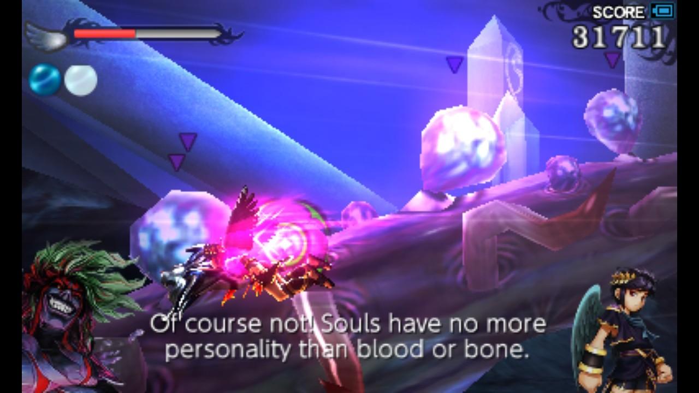
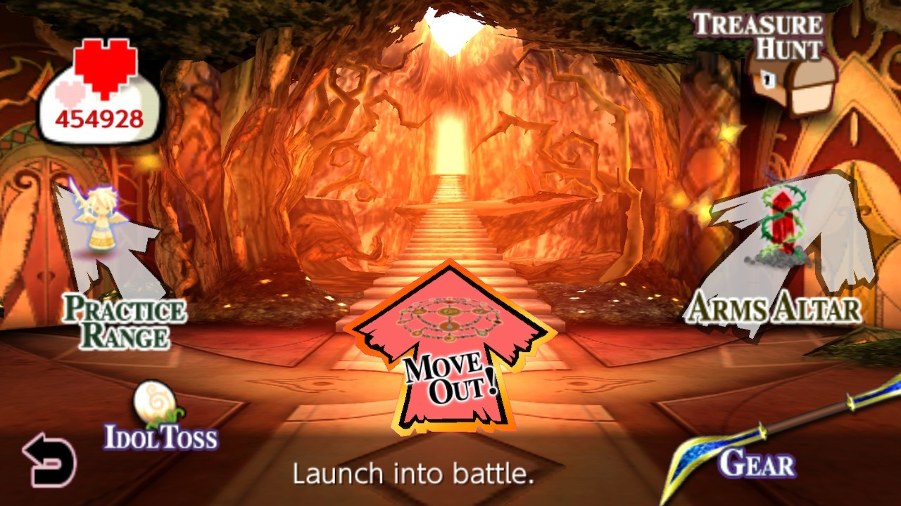
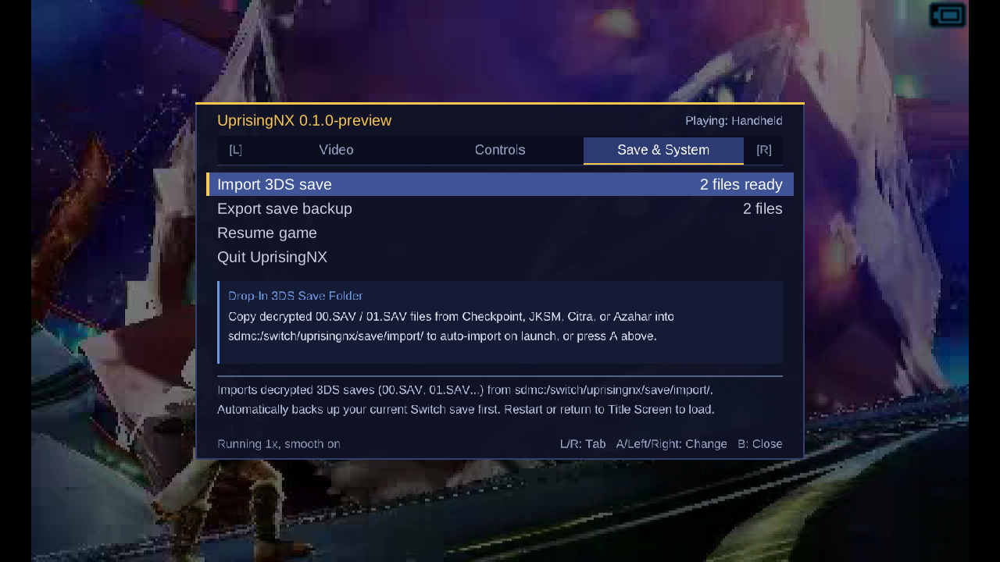
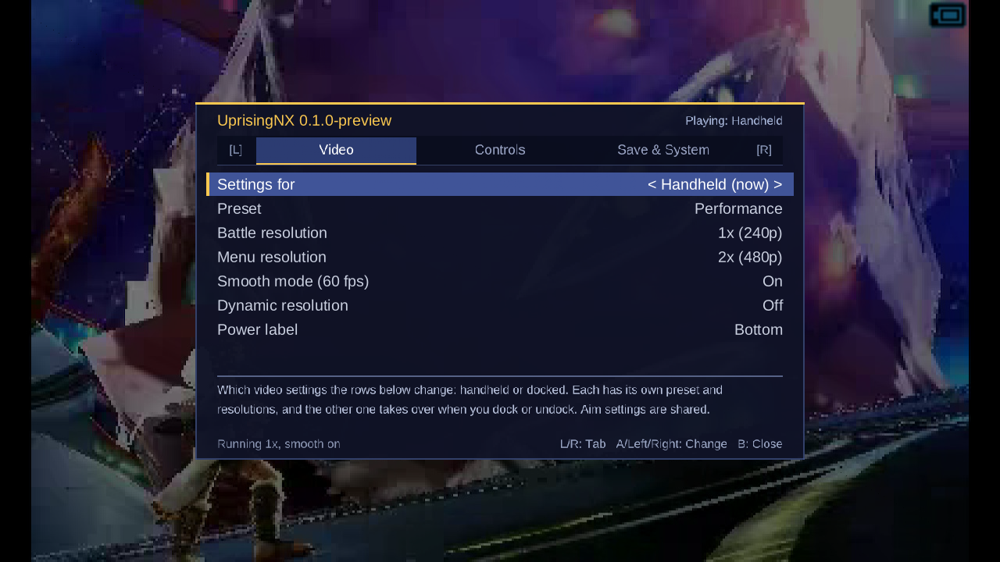
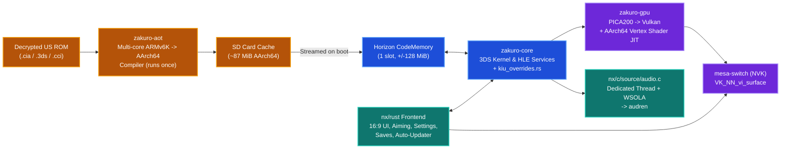

# Kid Icarus: Uprising for Nintendo Switch (UprisingNX)

**UprisingNX** is a self-bootstrapping ahead-of-time (AOT) recompilation and native runtime port of *Kid Icarus: Uprising* (Nintendo 3DS, USA `0004000000030100` / `CTR-P-AKDE`) for the Nintendo Switch.

`uprising_nx.nro` ships with **zero copyrighted game code or assets**. On first launch, UprisingNX validates your legally dumped, decrypted US ROM and compiles all `12.14 MB` of ARMv6K + VFPv2 game code directly into native AArch64 machine code on your Switch, caching the result to your SD card for fast launches afterward.

---

## Gameplay Demo

[](https://www.youtube.com/watch?v=jP63aGFbcz8)

**[Watch Gameplay on YouTube →](https://www.youtube.com/watch?v=jP63aGFbcz8)**

| Title Screen (16:9 Upscaled) | Air Battle & Unified HUD |
| :---: | :---: |
|  |  |

---

## Quick Start

1. **Extract the release** — Download `UprisingNX-vX.Y.Z.zip` from [Releases](https://github.com/Angle-Brackets/UprisingNX/releases) and extract the `switch/` folder to the root of your SD card.

2. **Add your decrypted US ROM** — Copy your decrypted USA 1.0 *Kid Icarus: Uprising* dump (`.cia`, `.3ds`, or `.cci`, Title ID `0004000000030100`) into:
   ```text
   sdmc:/switch/uprisingnx/rom/
   ```
   Any filename works (e.g., `baserom.cia`). Encrypted dumps must be decrypted on your 3DS with GodMode9 first.

3. **Launch via Title Override** — Hold **R** while opening any installed Switch game from the HOME Menu to enter Homebrew Menu with full memory and JIT permissions, then launch **UprisingNX**:
   - **First launch:** Compiles your ROM on-console to native AArch64 (~30–60s with a live progress bar) and saves the cache to your SD card.
   - **Subsequent launches:** Streams the cached binary directly into executable memory without recompiling.


### SD Card Layout

```text
sdmc:/switch/uprisingnx/
├── uprising_nx.nro                         # Switch homebrew executable
├── settings.ini                            # Auto-generated preferences
├── rom/
│   └── baserom.cia                         # Your decrypted US 1.0 ROM (.cia/.3ds/.cci)
├── cache/
│   └── aot_v1_0004000000030100_*.bin       # On-console compiled AArch64 cache
├── save/
│   ├── import/                             # Drop 3DS saves here for automatic import
│   └── export/                             # Exported 3DS-compatible backups
└── data/
    ├── cache/pipelines/                    # Cached Tegra Vulkan graphics pipelines
    └── user/savedata/0004000000030100/     # Live save data
```

---

## Features

### Unified 16:9 Single-Screen UI

Every major screen—Title Screen, Mode Select, Solo Hub, Chapter Select, Fiend's Cauldron, Arms Altar, Gear, Weapon Fusion, and the in-battle HUD & dialogue portraits—has been reworked for a single 16:9 handheld or TV display instead of cramped side-by-side 3DS screens.

| Solo Hub | Chapter Select |
| :---: | :---: |
|  |  |

| Fiend's Cauldron | Weapon Select |
| :---: | :---: |
|  |  |

<br>

### Dual-Stick, Gyro & Zelda-Style Z-Targeting

- **Dual-Stick & Gyro Aiming:** Native analog camera and reticle control with optional gyroscope aiming, independent sensitivity tuning, Y-axis inversion, and left-stick aim options.
- **Z-Targeting & Recenter (`R` / `L3`):** Tap or hold **R** (or **Left Stick Click**) on foot to lock onto nearby enemies—covering a `360°` close-range bubble within `16` units or a `±85°` forward cone up to `52` units prioritizing your crosshair. Holding maintains a tight 1:1 camera lock for circle-strafing and automatically re-acquires nearby enemies; tapping with no target smoothly swings the camera behind Pit.

<br>

### Baked-In Shader Warmup

UprisingNX embeds **493 portable *Kid Icarus: Uprising* PICA200 pipeline keys** directly inside `uprising_nx.nro`. On startup, these keys warm up native Switch Vulkan pipelines in the background and persist them to your SD card, cutting down first-playthrough shader compilation hitches.

<br>

### In-App Auto-Updater

When Wi-Fi is connected, UprisingNX performs a quiet check against GitHub Releases on the Title Screen (silently skipping when offline) and displays a yellow **`Update Available!`** notice above the version watermark whenever a newer release is out.

Open **Settings → Save & System → Software update** to check on demand, download the verified `uprising_nx.nro` in the background, and atomically swap & relaunch into the new version.

<br>

### 3DS Save Import & Export

Decrypted US saves (`00.SAV`, `01.SAV`, etc.) from Checkpoint, JKSM, Citra, and Azahar are directly compatible:

- **Drop-in auto-import:** Copy your `.SAV` files (or a Checkpoint backup folder) into `sdmc:/switch/uprisingnx/save/import/` before launching. UprisingNX automatically backs up your current Switch save, imports your 3DS save with the required `.format` header, and archives the consumed files.
- **In-menu import & export:** Open **Settings → Save & System** anytime to import saves or export a clean backup to `sdmc:/switch/uprisingnx/save/export/`.



---

## Controls & Settings

### Controls & Hotkeys

| Input | Action |
| --- | --- |
| **Left / Right Stick + Gyro** | Movement & native aiming / camera control |
| **R** or **Left Stick Click (`L3`)** | Z-Target enemy (tap or hold) / recenter camera behind Pit |
| **Right Stick Click (`R3`)** | Toggle bottom screen overlay |
| **`Minus` (`-`)** | Open / close tabbed Settings menu (`L` / `R` switches tabs) |
| **`Plus` (`+`)** | 3DS `Start` |
| **Hold `R3` + D-Pad Left** | Cycle Handheld / Docked preset (`Performance` → `Quality` → `Custom`) |
| **Hold `R3` + D-Pad Up / Down** | Adjust internal resolution (`1x`–`4x`) for battles or menus |
| **Hold `R3` + D-Pad Right** | Toggle Smooth Mode (up to 60 fps frame interpolation) |
| **`Plus` + `Minus`** | Quit immediately |

### Video Presets & Performance Targets (`settings.ini`)

Handheld and Docked configurations are stored independently in `sdmc:/switch/uprisingnx/settings.ini` and switch automatically when docking or undocking:

| Preset | Mode | Resolution | Smooth Mode | Performance Target |
| --- | --- | --- | --- | --- |
| **`performance`** *(default)* | Handheld | Battles `1x` (240p) · Menus `2x` (480p) | **On** | **Up to 60 fps** (interpolated from 30 fps) |
| **`performance`** *(default)* | Docked | Battles `3x` (720p) · Menus `4x` (960p) | **On** | **Up to 60 fps** (interpolated from 30 fps) |
| **`quality`** | Handheld | `2x` (480p) everywhere | Off | **Locked 30 fps** (native KIU cadence) |
| **`quality`** | Docked | `4x` (960p) everywhere | Off | **Locked 30 fps** (native KIU cadence) |
| **`custom`** | Handheld / Docked | User-defined `1x`–`4x` (`battle_scale`, `menu_scale`) | User-defined | Depends on chosen scale & dynamic resolution |

*Kid Icarus: Uprising* runs its core simulation at 30 fps on 3DS. **Smooth Mode** doubles visual output toward **60 fps** via frame interpolation and automatically backs off temporarily during GPU-heavy bursts so frame pacing stays steady, then re-engages once headroom returns.



---

## Known Limitations (v0.1)

- **Title Override required:** Album (Applet) mode restricts memory and JIT permissions and is not supported.
- **USA 1.0 ROM only:** Only the decrypted USA 1.0 release (`0004000000030100`) is currently supported. EU/JP releases and encrypted dumps are rejected with a setup notice.
- **First-launch compilation wait:** Compiling the ROM on-console takes ~30–60 seconds on the very first boot.
- **Offline / solo only:** Local single-player only—online multiplayer and StreetPass are not implemented.
- **Occasional first-time shader hitches:** New visual effects encountered before background warmup finishes may briefly hitch once while their Vulkan pipeline compiles and caches to the SD card.

---

## Architecture & Design Decisions

UprisingNX is split into four cooperating layers: an **on-console AOT compiler**, a **Horizon 3DS kernel & runtime**, a **PICA200 → Vulkan GPU pipeline**, and a **Switch-native frontend**.



> **Layer Legend:** **Amber** = ROM & On-Switch AOT Compiler · **Blue** = Horizon CodeMemory & 3DS Core · **Purple** = PICA200 → Vulkan GPU Stack · **Teal** = Switch Frontend & Audio

### 1. Why On-Switch Self-Bootstrapping AOT?
Traditional static recompilation (compiling 3DS code to C/AArch64 on a PC and linking it into the binary) either forces users to run a desktop toolchain or embeds copyrighted game code in the release. Pure interpreters are far too slow on the Tegra X1's Cortex-A57 cores, and a full dynamic CPU JIT competes heavily with Horizon's strict executable-memory limits.

UprisingNX takes a middle path—**self-bootstrapping AOT on the Switch itself** (`zakuro/crates/zakuro-aot/`):
- **Zero game code in `uprising_nx.nro`:** The compiler reads the user's ROM directly on the console, translates ARMv6K, Thumb, and VFPv2 instructions to position-independent AArch64 across CPU cores, and writes a reusable binary cache to the SD card.
- **Single-`CodeMemory` budget (`~87 MiB`):** Horizon OS caps a process at **10 `CodeMemory` regions**, and AArch64 direct branches (`B`/`BL`) have a `±128 MiB` reach. By using **1.0× single-owner instruction deduplication** (each guest instruction is emitted once rather than duplicated across overlapping CFG paths), all `12.14 MB` of *Kid Icarus: Uprising* compiles into `~87 MiB` of native AArch64. That fits inside **one** `CodeMemory` slot with direct relative branches, leaving the remaining 9 slots free for the GPU vertex shader JIT.
- **Literal-pool folding & NEON intrinsics:** Constant pools embedded in `.text` are folded directly into AArch64 immediates, and hot MobiClip video-decode routines are lowered to hardware AArch64 ASIMD (NEON) intrinsics.

### 2. Surgical Gameplay Hooks (`kiu_overrides.rs`)
*Kid Icarus: Uprising* was designed around a touchscreen stylus and two stacked 4:3/5:3 displays. Simple input emulation leaves camera movement sluggish because KIU routes touch deltas through an internal spring-damper and deadzone.

Instead of patching the ROM on disk, `zakuro-aot` binds targeted Rust overrides (`zakuro/crates/zakuro-aot/src/kiu_overrides.rs`) directly at compile/link time to:
- Bypass the stylus damper during Z-targeting and write camera angles directly for responsive 1:1 lock-on and circle-strafing.
- Drive unified 16:9 single-screen layouts and HUD positioning without breaking underlying menu state machines.
- Coordinate 30 → 60 fps interpolation cleanly with the game's frame pacing.

### 3. PICA200 → Vulkan & Portable Shader Warmup
`zakuro-gpu` translates 3DS PICA200 fixed-function TEV combiners and rasterization state to Vulkan via statically linked `mesa-switch` (Nouveau/NVK on Tegra X1) presenting to `VK_NN_vi_surface`, while PICA200 programmable vertex shaders run on a multi-threaded AArch64 JIT (`zakuro-gpu/src/shader/jit.rs`).

Distributing pre-compiled binary `VkPipelineCache` blobs is brittle across Mesa updates and large. Instead, UprisingNX embeds **493 compact, driver-independent PICA200 pipeline keys** (~67 KB) directly inside the `.nro`. On boot, the background compiler turns those keys into native Tegra pipelines automatically and persists the resulting `VkPipelineCache` to the SD card—giving fast warmup with zero driver coupling.

### 4. Dedicated Audio Thread with WSOLA Time-Stretching
The 3DS generates audio in emulated time (one 160-sample frame at 32,728 Hz every ~4.9 emulated ms). If a heavy battle frame briefly dips below full speed, a naive audio queue runs dry and crackles.

`nx/c/source/audio.c` decouples playback onto its own thread feeding Horizon's `audren` service through a **WSOLA (Waveform Similarity Overlap-Add)** time-stretcher. The stretcher smoothly adjusts playback tempo to match ring-buffer fill, preventing clicks and pitch drops during brief slowdowns without ever blocking the game thread.

### 5. Repository Layout

| Path | Role |
| --- | --- |
| `nx/rust/src/` | Switch frontend staticlib: main loop (`lib.rs`), AOT bootstrapper (`bootstrap.rs`), aiming (`aim.rs`), tabbed overlay UI (`menu.rs`), 3DS save manager (`saves.rs`), settings (`settings.rs`), GitHub auto-updater (`updater.rs`) |
| `nx/c/` | `libnx` C shell, `Makefile` / NRO packaging, `CodeMemory` JIT/AOT allocator (`jit.c`), WSOLA `audren` audio thread (`audio.c`), libcurl/SSL + `nifm` updater helpers (`updater.c`) |
| `zakuro/crates/zakuro-aot/` | On-Switch ARMv6K/Thumb/VFPv2 → AArch64 AOT compiler, binary cache streamer, and KIU gameplay overrides (`kiu_overrides.rs`) |
| `zakuro/crates/zakuro-core/` | Horizon-ported 3DS kernel, HLE services, memory bus, and RomFS/mod loader |
| `zakuro/crates/zakuro-gpu/` | PICA200 → Vulkan renderer (`mesa-switch`), AArch64 vertex shader JIT, and baked KIU pipeline warmup keys |
| `zakuro/crates/zakuro-fs/` | `.cia` / `.3ds` / `.cci` / `.cxi` ROM parser and encryption validator |
| `scripts/` | Switch Rust build wrapper (`cargo-nx.sh`), Horizon `std` setup (`horizon-std-setup.sh`), and verified release builder (`release.sh`) |
| `patches/` | Patches for Horizon `libc`, `target-lexicon`, and `mesa-switch` cross-compilation |

---

## Building & Releasing

Requires **devkitPro (`devkitA64` + `libnx` + Switch `portlibs`)**, nightly Rust with Horizon `std` sources set up via `scripts/horizon-std-setup.sh`, and a built `mesa-switch` `libvulkan.a` in `build/mesa/`.

1. **Build the Rust staticlib (runtime, AOT compiler, and Switch frontend):**
   ```bash
   cd nx/rust && RUST_MIN_STACK=16777216 ../../scripts/cargo-nx.sh build --release
   ```
   *(Pass `UNX_RELEASE_TAG=vX.Y.Z` for tagged release builds so the version watermark and auto-updater match the release tag.)*

2. **Link and package `uprising_nx.nro`:**
   ```bash
   make -C nx/c KICKSTAND=0
   ```

3. **Cutting a release:**
   Update `VERSION` and `nx/rust/Cargo.toml` together, commit and push to `main`, then run:
   ```bash
   ./scripts/release.sh
   ```
   Both `scripts/release.sh` and `.github/workflows/tag-build.yml` enforce that `VERSION` is bumped past the previous release and matches `nx/rust/Cargo.toml` before tagging or publishing.

---

## Credits & License

- **License:** UprisingNX is released under the [MIT License](LICENSE). Built on **Zakuro** (`zakuro/LICENSE`, MIT License, Copyright © 2026 fearkov).
- **3D Switch Tutorial Assets** ([CC BY 4.0](https://creativecommons.org/licenses/by/4.0/), modified with articulated controls for UprisingNX):
  - *"Nintendo Switch"* console mesh by **gabrieljuan0322** ([Sketchfab](https://sketchfab.com/3d-models/nintendo-switch-19f3d13edffd4e85acfbbe8adefb72fb))
  - *"Joy-con Switch"* controllers by **Wevensson** ([Sketchfab](https://sketchfab.com/3d-models/joy-con-switch-f8cf0fb92ac544d38079e8d294a5330a))
- **MobiClip `.moflex` Video Encoding:** [`quatric/mobipeg`](https://github.com/quatric/mobipeg) + [`quatric/x264`](https://github.com/quatric/x264)
