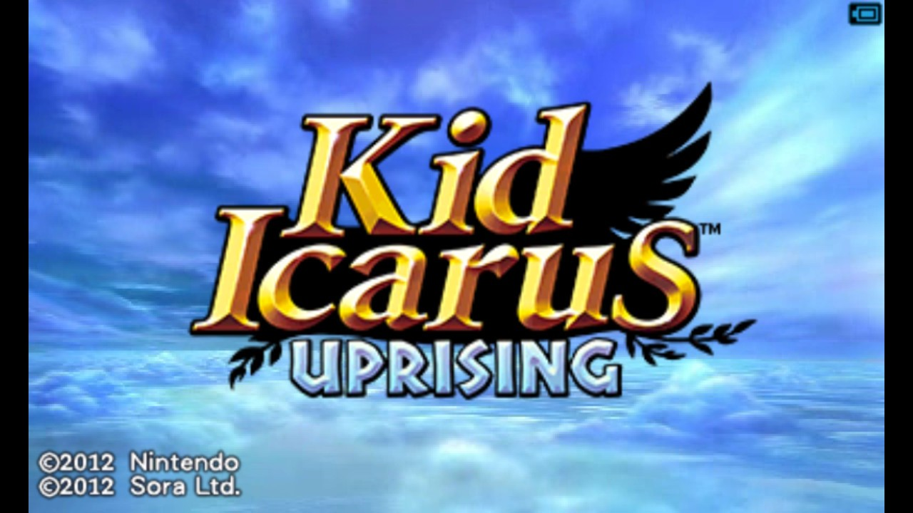
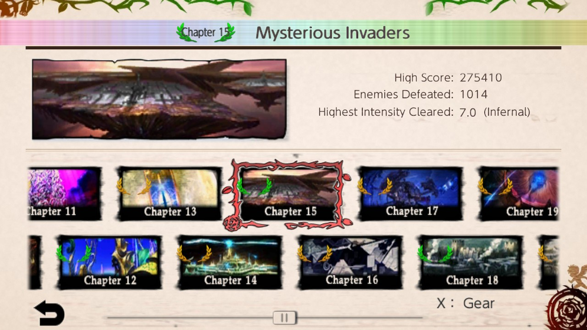
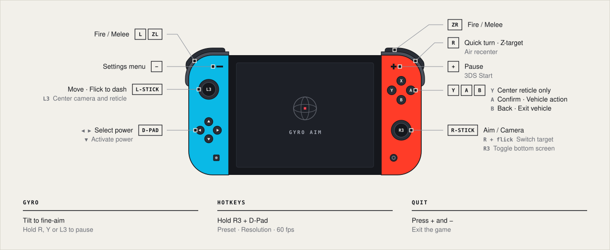
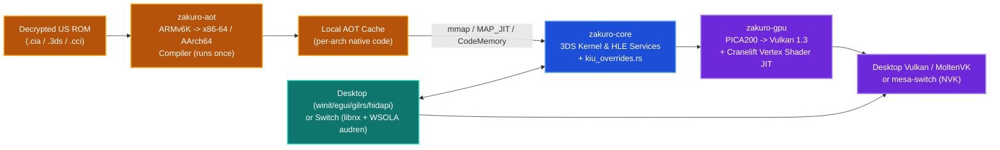

# Kid Icarus: Uprising Recompiled (UprisingNX)

**UprisingNX** is a self-bootstrapping ahead-of-time (AOT) recompilation and native runtime port of *Kid Icarus: Uprising* (Nintendo 3DS, USA `0004000000030100` / `CTR-P-AKDE`) for **Windows**, **macOS (Apple Silicon)**, **Linux / Steam Deck**, and **Nintendo Switch**.

Every release ships with **zero copyrighted game code or assets**. On first launch, the app validates your legally dumped, decrypted US 1.0 ROM and compiles all `12.14 MB` of ARMv6K + Thumb + VFPv2 game code directly into native **x86-64** or **AArch64** machine code on your device, caching the compiled binary for instant launches afterward.

---

## Gameplay Demo

**[Watch Gameplay on YouTube →](https://www.youtube.com/watch?v=jP63aGFbcz8)**  
*(Recorded on an older Switch build; v0.2.0 brings the full native PC & macOS port alongside Switch.)*

| Title Screen (16:9 Upscaled) | Air Battle & Unified HUD |
| :---: | :---: |
|  |  |

| Desktop Settings — Graphics | Desktop Settings — Controller & Gyro |
| :---: | :---: |
|  |  |

---

## Quick Start

> **ROM Requirement (All Platforms):** You need a legally dumped, **decrypted USA 1.0** copy of *Kid Icarus: Uprising* (`.cia`, `.3ds`, or `.cci`, Title ID `0004000000030100`). Encrypted dumps must be decrypted on your 3DS with GodMode9 first.

### Windows, macOS & Linux (PC / Steam Deck)

1. **Download from [Releases](https://github.com/Angle-Brackets/UprisingNX/releases):**
   - **Windows (x64):** `uprising-recompiled-windows-x64.exe` (requires a Vulkan 1.3 GPU driver)
   - **macOS (Apple Silicon):** `uprising-recompiled-macos-arm64.dmg` (drag **Kid Icarus Uprising Recompiled.app** to `/Applications`; bundles MoltenVK 1.4+)
   - **Linux / Steam Deck (x64):** `uprising-recompiled-linux-x64.tar.gz` (extract and run `./uprising-recompiled`)
2. **Import your ROM on first launch:** Click **Select ROM** (or drag-and-drop your decrypted `.cia` / `.3ds` / `.cci` onto the window). The app imports the ROM, compiles it to native x86-64 or AArch64 in a few seconds, caches it, and boots straight into the game.
3. **Enjoy:** Press **`Esc`** in-game for the Pause / Settings menu, or **`F11`** to toggle fullscreen.

**Desktop Data Directory** (saves, settings, imported ROM, AOT cache):
- **Windows:** `%APPDATA%\zakuro\`
- **macOS:** `~/Library/Application Support/zakuro/`
- **Linux / Steam Deck:** `~/.local/share/zakuro/` (or `$XDG_DATA_HOME/zakuro/`)

---

### Nintendo Switch

1. **Extract the release** — Download `UprisingNX-vX.Y.Z.zip` from [Releases](https://github.com/Angle-Brackets/UprisingNX/releases) and extract the `switch/` folder to the root of your SD card.
2. **Add your decrypted US ROM** — Copy your decrypted USA 1.0 *Kid Icarus: Uprising* dump (`.cia`, `.3ds`, or `.cci`) into:
   ```text
   sdmc:/switch/uprisingnx/rom/
   ```
   Any filename works (e.g., `baserom.cia`).
3. **Launch via Title Override** — Hold **R** while opening any installed Switch game from the HOME Menu to enter Homebrew Menu with full memory and JIT permissions, then launch **UprisingNX**:
   - **First launch:** Compiles your ROM on-console to native AArch64 (~30–60s with a live progress bar) and saves the cache to your SD card.
   - **Subsequent launches:** Streams the cached binary directly into executable memory without recompiling.


<details>
<summary>Switch SD Card Layout</summary>

```text
sdmc:/switch/uprisingnx/
├── uprising_nx.nro                         # Switch homebrew executable
├── settings.ini                            # Auto-generated preferences
├── rom/
│   └── baserom.cia                         # Your decrypted US 1.0 ROM (.cia/.3ds/.cci)
├── cache/
│   └── aot_v1_0004000000030100_*.bin       # On-console compiled AArch64 cache
├── save/
│   ├── import/                             # Drop 3DS saves here for automatic import
│   └── export/                             # Exported 3DS-compatible backups
└── data/
    ├── cache/pipelines/                    # Cached Tegra Vulkan graphics pipelines
    └── user/savedata/0004000000030100/     # Live save data
```

</details>

---

## Features

### Unified 16:9 Single-Screen UI & HD Upscaling

Every major screen—Title Screen, Mode Select, Solo Hub, Chapter Select, Fiend's Cauldron, Arms Altar, Gear, Weapon Fusion, and the in-battle HUD & dialogue portraits—has been reworked for a single 16:9 display instead of cramped side-by-side 3DS screens. On PC & macOS, internal resolution scales up to **16×** with hardware-aware first-launch quality defaults and **Smooth Mode** (up to 60 fps frame interpolation).

| Solo Hub | Chapter Select |
| :---: | :---: |
|  |  |

| Fiend's Cauldron | Weapon Select |
| :---: | :---: |
|  |  |

<br>

### Keyboard + Mouse, Twin-Stick, Gyro & Zelda-Style Z-Targeting

- **Direct Mouse + Keyboard (PC/macOS):** Play naturally with `WASD` movement, raw mouse aiming, left-click fire, right-click / middle-click power activation, and mouse-wheel power cycling.
- **Twin-Stick & Native HID Gyro Aiming:** Full analog camera and reticle control with Switch-parity `L`/`ZL`/`ZR` firing, plus native gyroscope aiming on **Nintendo Switch**, **DualSense**, **DualShock 4**, **Switch Pro**, and **Steam Deck** controllers—complete with independent sensitivity tuning and separate Air / Ground Y-axis inversion.
- **Z-Targeting (`R`) & Reticle Center (`Y` / `L3`):** Tap or hold **R** on foot to quick-turn / lock directly onto visible enemies up to `160` units away (`±65°` forward cone prioritizing your crosshair, with a `360°` fallback within `80` units if a boss dashes past you) while centering the reticle. Holding **R** maintains a tight 1:1 lock for circle-strafing and flicking the right stick switches targets. Press **Y** on foot to center **only the reticle** (without moving the camera) or click **Left Stick (`L3`)** to center both camera and reticle behind Pit. In Air Battles, **R**, **Y**, and **L3** all recenter the reticle.

<br>

### Baked-In Shader Warmup

UprisingNX embeds **493 portable *Kid Icarus: Uprising* PICA200 pipeline keys** directly inside the executable. On startup, these keys warm up native Vulkan pipelines in the background and cache them to disk, cutting down first-playthrough shader compilation hitches.

<br>

### 3DS Save Import & Export & Switch OTA Auto-Updater

- **3DS Save Compatibility:** Decrypted US saves (`00.SAV`, `01.SAV`, etc.) from Checkpoint, JKSM, Citra, and Azahar work directly. On Switch, drop `.SAV` files into `sdmc:/switch/uprisingnx/save/import/` or manage them in **Settings → Save & System**. On PC/macOS, saves live in `<data_dir>/user/savedata/0004000000030100/`.
- **Switch In-App Auto-Updater:** When Wi-Fi is connected, UprisingNX checks GitHub Releases / `versions.json` quietly on the Title Screen and lets you update or switch versions directly from **Settings → Save & System → Software update / Version history**.

---

## Controls & Settings

### PC & macOS Controls

| Input | Keyboard + Mouse | Gamepad (Xbox / PlayStation / Nintendo) |
| --- | --- | --- |
| **Move / Dash** | `W` `A` `S` `D` | Left Stick |
| **Aim / Camera** | Mouse (raw aim) | Right Stick + HID Gyro |
| **Fire / Melee** | `Left Click` (or `Space`) | `LB`/`L1`/`L`, `LT`/`L2`/`ZL`, or `RT`/`R2`/`ZR` |
| **Z-Target / Quick Turn** | `R` | `RB` / `R1` / `R` |
| **Center Reticle / Camera** | `T` (reticle) | `Y`/`Triangle`/`X` (reticle) · `L3` (camera + reticle) |
| **Activate Power** | `Right Click` / `Middle Click` / `F` | D-Pad Down |
| **Cycle Powers** | `Mouse Wheel` / `Q` `E` | D-Pad Left / Right |
| **Pause / Settings Menu** | `Esc` (app pause/settings) · `P` (3DS Start) | `Start`/`Options`/`+` (3DS Start) · `Back`/`Share`/`-` (Select) |
| **Fullscreen / Toggle Aim** | `F11` (fullscreen) · `F1` (release/capture mouse) | — |

All keyboard bindings, controller presets, stick deadzones, button glyph styles (`Auto` / `Xbox` / `PlayStation` / `Nintendo`), and gyro tuning can be configured live in **Settings → Controls / Controller**.

---

### Nintendo Switch Controls & Presets



| Input | Action |
| --- | --- |
| **Left / Right Stick + Gyro** | Movement & native aiming / camera control |
| **R** | Quick Turn / Z-Target + center reticle on foot (tap to snap, hold to lock 1:1, right-stick flick to switch) / recenter reticle in air |
| **Y** | Center reticle only on foot (keeps camera angle, pauses gyro while held) / recenter reticle in air |
| **Left Stick Click (`L3`)** | Dedicated center camera & reticle behind Pit (on foot) / recenter reticle (air) |
| **Right Stick Click (`R3`)** | Toggle bottom screen overlay |
| **`Minus` (`-`)** | Open / close tabbed Settings menu (`L` / `R` switches tabs) |
| **`Plus` (`+`)** | 3DS `Start` |
| **Hold `R3` + D-Pad Left** | Cycle Handheld / Docked preset (`Performance` → `Quality` → `Custom`) |
| **Hold `R3` + D-Pad Up / Down** | Adjust internal resolution (`1x`–`4x`) for battles or menus |
| **Hold `R3` + D-Pad Right** | Toggle Smooth Mode (up to 60 fps frame interpolation) |
| **`Plus` + `Minus`** | Quit immediately |

<details>
<summary>Switch Handheld / Docked Video Presets (settings.ini)</summary>

Handheld and Docked configurations are stored independently in `sdmc:/switch/uprisingnx/settings.ini` and switch automatically when docking or undocking:

| Preset | Mode | Resolution | Smooth Mode | Performance Target |
| --- | --- | --- | --- | --- |
| **`performance`** *(default)* | Handheld | Battles `1x` (240p) · Menus `2x` (480p) | **On** | **Up to 60 fps** (interpolated from 30 fps) |
| **`performance`** *(default)* | Docked | Battles `3x` (720p) · Menus `4x` (960p) | **On** | **Up to 60 fps** (interpolated from 30 fps) |
| **`quality`** | Handheld | `2x` (480p) everywhere | Off | **Locked 30 fps** (native KIU cadence) |
| **`quality`** | Docked | `4x` (960p) everywhere | Off | **Locked 30 fps** (native KIU cadence) |
| **`custom`** | Handheld / Docked | User-defined `1x`–`4x` (`battle_scale`, `menu_scale`) | User-defined | Depends on chosen scale & dynamic resolution |

</details>

---

## Known Limitations (v0.2)

- **USA 1.0 ROM only:** Only the decrypted USA 1.0 release (`0004000000030100`) is currently supported. EU/JP releases and encrypted dumps are rejected with a setup notice.
- **Vulkan 1.3 required on PC:** Windows and Linux require a Vulkan 1.3-capable GPU and driver (macOS bundles MoltenVK 1.4+ over Metal on Apple Silicon).
- **Switch requires Title Override:** Album (Applet) mode restricts memory and JIT permissions and is not supported.
- **Offline / solo only:** Local single-player only—online multiplayer and StreetPass are not implemented.
- **Occasional first-time shader hitches:** New visual effects encountered before background warmup finishes may briefly hitch once while their Vulkan pipeline compiles and caches to disk.

---

## Architecture & Design Decisions

UprisingNX is split into four cooperating layers: a **self-bootstrapping AOT compiler (`x86-64` & `AArch64`)**, a **3DS kernel & runtime**, a **PICA200 → Vulkan 1.3 GPU pipeline**, and **platform frontends** (Desktop + Switch).



> **Layer Legend:** **Amber** = ROM & Self-Bootstrapping AOT Compiler · **Blue** = 3DS Core & Overrides · **Purple** = PICA200 → Vulkan GPU Stack · **Teal** = Desktop & Switch Frontends

### Repository Layout

| Path | Role |
| --- | --- |
| `platforms/pc/` | Desktop entry point (`uprising-recompiled`), Windows icon resource (`build.rs`), macOS `Info.plist` & Hardened Runtime entitlements |
| `platforms/nx/rust/` | Switch frontend staticlib: main loop, AOT bootstrapper, aiming, tabbed overlay UI, 3DS save manager, settings, GitHub auto-updater |
| `platforms/nx/c/` | `libnx` C shell, `Makefile` / NRO packaging, `CodeMemory` allocator (`jit.c`), WSOLA `audren` audio thread (`audio.c`), libcurl/SSL updater helpers |
| `crates/kiu-common/` | Shared *Kid Icarus: Uprising* layouts, UI state detection, aiming math, and baked PICA200 pipeline warmup keys |
| `zakuro/crates/zakuro/` | Desktop application shell (`winit` + `egui` parchment Settings/Pause/Setup UI, `gilrs` gamepad, `hidapi` gyro, `cpal` audio) |
| `zakuro/crates/zakuro-aot/` | Self-bootstrapping ARMv6K/Thumb/VFPv2 → `x86-64` & `AArch64` AOT compiler, cache streamer, and KIU gameplay overrides (`kiu_overrides.rs`) |
| `zakuro/crates/zakuro-core/` | 3DS kernel, HLE services, memory bus, and RomFS/mod loader |
| `zakuro/crates/zakuro-gpu/` | PICA200 → Vulkan 1.3 renderer (desktop Vulkan, MoltenVK, `mesa-switch`) and Cranelift vertex shader JIT |
| `zakuro/crates/zakuro-fs/` | `.cia` / `.3ds` / `.cci` / `.cxi` ROM parser and encryption validator |
| `scripts/pc/` | Desktop build & packaging scripts (`build-pc.sh`, `build-macos.sh`) |
| `scripts/nx/` | Switch Rust build wrapper (`cargo-nx.sh`) and Horizon `std` setup (`horizon-std-setup.sh`) |
| `scripts/release/` | Verified release & snapshot publishers (`release.sh`, `snapshot.sh`) |

---

## Building & Releasing

### PC (Linux & Windows)

Requires **Rust 1.95+**. On Linux, also install `pkg-config`, `libasound2-dev`, `libudev-dev`, and `libclang-dev`.

```bash
# Linux
./scripts/pc/build-pc.sh

# Windows (PowerShell)
cargo build --release -p uprising-recompiled
```

### macOS (Apple Silicon)

Requires **Rust 1.95+** and **MoltenVK >= 1.3.0** (`brew install molten-vk`).

```bash
./scripts/pc/build-macos.sh --arch arm64
```

Produces `build/pc/Kid Icarus Uprising Recompiled.app` and `build/pc/uprising-recompiled-macos-arm64.dmg`. Set `APPLE_SIGN_IDENTITY` (and `APPLE_NOTARY_KEY_PATH` / `APPLE_NOTARY_KEY_ID` / `APPLE_NOTARY_ISSUER`) to Developer-ID-sign and notarize automatically.

### Nintendo Switch

Requires **devkitPro (`devkitA64` + `libnx` + Switch `portlibs`)**, nightly Rust with Horizon `std` sources set up via `scripts/nx/horizon-std-setup.sh`, and a built `mesa-switch` `libvulkan.a` in `build/mesa/`.

```bash
cd platforms/nx/rust && RUST_MIN_STACK=16777216 ../../../scripts/nx/cargo-nx.sh build --release
make -C platforms/nx/c clean && make -C platforms/nx/c KICKSTAND=0
```

### Cutting a Release

Update `VERSION` and `platforms/nx/rust/Cargo.toml` together, commit and push to `main`, then run `./scripts/release/release.sh` (or push tag `vX.Y.Z`, which triggers `.github/workflows/tag-build.yml` to build and attach Windows, macOS, and Linux artifacts automatically).

---

## Credits & License

- **License:** UprisingNX is released under the [MIT License](LICENSE). Built on **Zakuro** (`zakuro/LICENSE`, MIT License, Copyright © 2026 fearkov).
- **Hardware Tooling:** Switch bring-up profiled and verified on real hardware with **[Kickstand](https://github.com/Angle-Brackets/kickstand)**.
- **3D Switch Tutorial Assets** ([CC BY 4.0](https://creativecommons.org/licenses/by/4.0/), modified with articulated controls for UprisingNX):
  - *"Nintendo Switch"* console mesh by **gabrieljuan0322** ([Sketchfab](https://sketchfab.com/3d-models/nintendo-switch-19f3d13edffd4e85acfbbe8adefb72fb))
  - *"Joy-con Switch"* controllers by **Wevensson** ([Sketchfab](https://sketchfab.com/3d-models/joy-con-switch-f8cf0fb92ac544d38079e8d294a5330a))
- **MobiClip `.moflex` Video Encoding:** [`quatric/mobipeg`](https://github.com/quatric/mobipeg) + [`quatric/x264`](https://github.com/quatric/x264)
