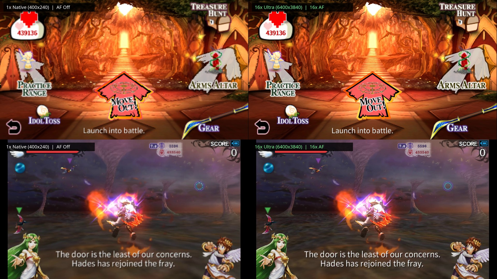
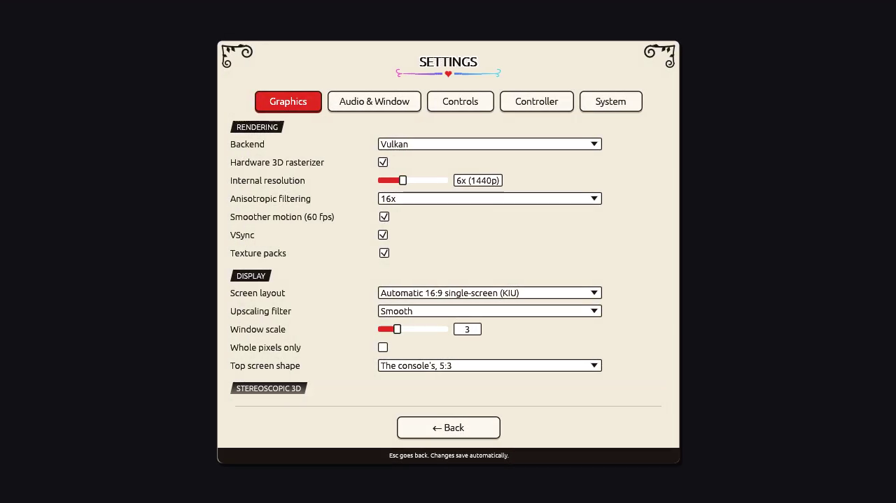
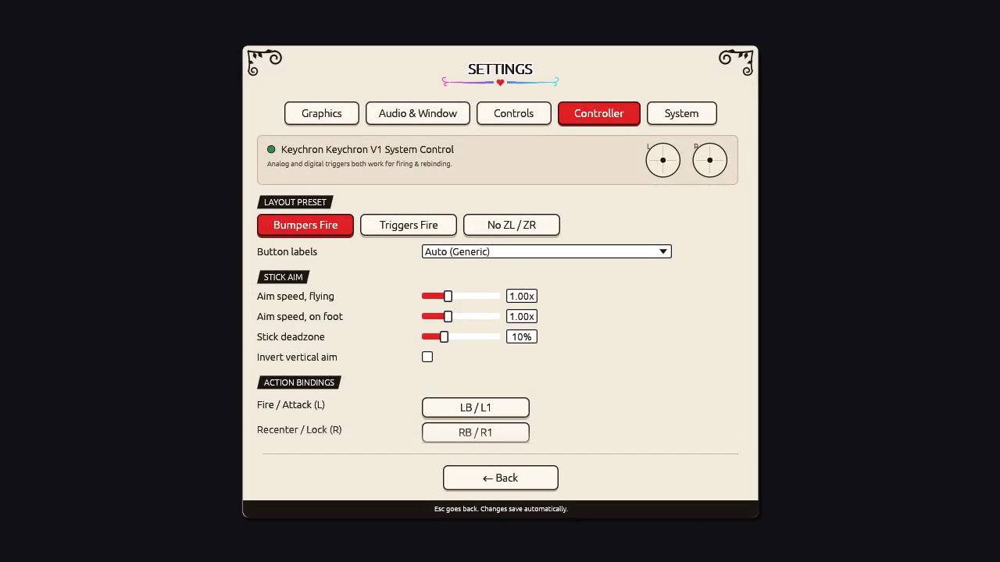
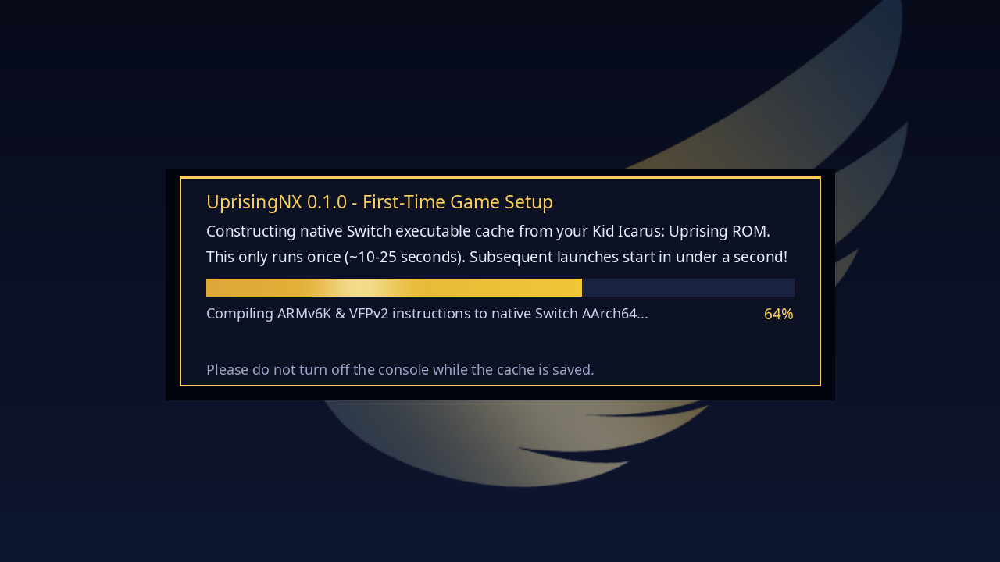
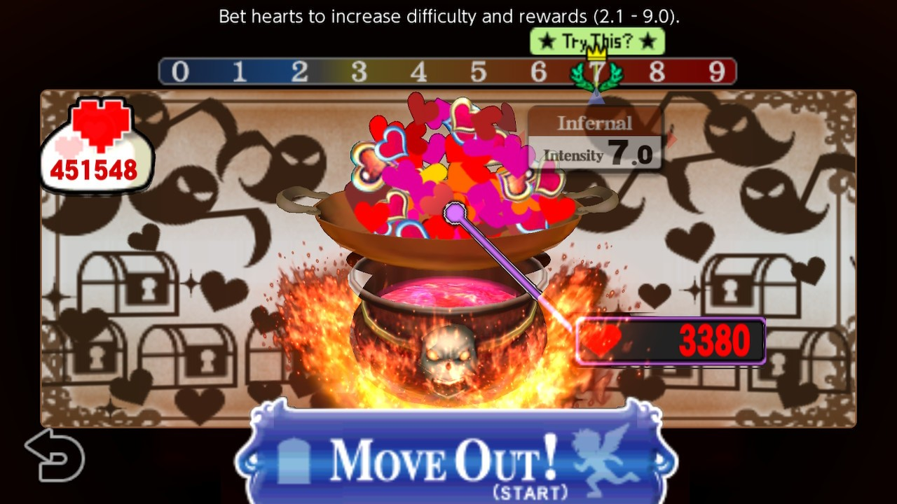
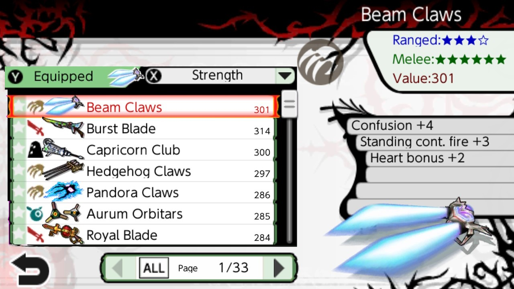
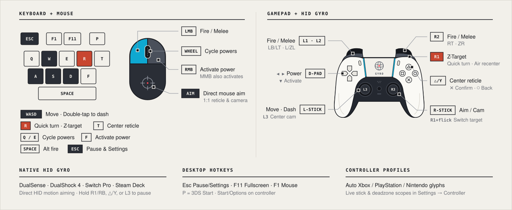
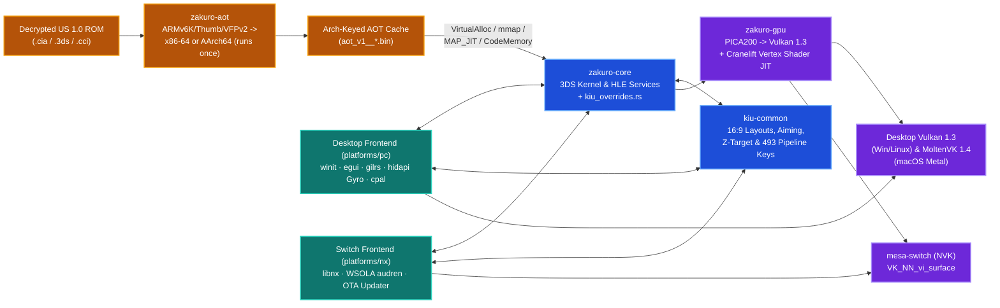

# Kid Icarus: Uprising Recompiled

A self-bootstrapping ahead-of-time (AOT) recompilation and native runtime port of *Kid Icarus: Uprising* (Nintendo 3DS, USA `0004000000030100` / `CTR-P-AKDE`) for **Windows**, **macOS (Apple Silicon)**, **Linux / Steam Deck**, and **Nintendo Switch** *(formerly **UprisingNX**)*.

Every release ships with **zero copyrighted game code or assets**. On first launch, the app validates your legally dumped, decrypted USA 1.0 ROM and compiles all `12.14 MB` of ARMv6K + Thumb + VFPv2 game code directly into native **x86-64** or **AArch64** machine code on your device, caching the compiled binary for instant launches afterward.

---

## Showcase

### Native 1× (3DS 240p) vs 16× Ultra HD (6400×3840 + 16× AF)



**[Watch Gameplay Demo on YouTube →](https://www.youtube.com/watch?v=jP63aGFbcz8)**  
*(Recorded on an earlier Switch build; v0.2.0 brings the full native Windows, macOS & Linux/Steam Deck port alongside Switch.)*

| Title Screen (16:9 Upscaled) | Air Battle & Unified HUD |
| :---: | :---: |
|  |  |

| Desktop Settings — Graphics | Desktop Settings — Controller & Gyro |
| :---: | :---: |
|  |  |

---

## Quick Start

> **ROM Requirement (All Platforms):** You need a legally dumped, **decrypted USA 1.0** copy of *Kid Icarus: Uprising* (`.cia`, `.3ds`, or `.cci`, Title ID `0004000000030100`). Encrypted dumps must be decrypted on your 3DS with GodMode9 first.

### Windows, macOS & Linux / Steam Deck

1. **Download from [Releases](https://github.com/Angle-Brackets/UprisingNX/releases):**
   - **Windows (x64):** `uprising-recompiled-windows-x64.exe` *(requires a Vulkan 1.3 GPU driver)*
   - **macOS (Apple Silicon `arm64`):** `uprising-recompiled-macos-arm64.dmg` *(drag **Kid Icarus Uprising Recompiled.app** to `/Applications`; bundles MoltenVK 1.4+)*
   - **Linux / Steam Deck (x64):** `uprising-recompiled-linux-x64.tar.gz` *(extract and run `./uprising-recompiled`)*
2. **Import your ROM on first launch:** Click **Select ROM** (or drag-and-drop your decrypted `.cia` / `.3ds` / `.cci` onto the window). The app imports the ROM, compiles it to native x86-64 or AArch64 in a few seconds, caches it, and boots straight into the game.
3. **Play:** Press **`Esc`** in-game for the Pause / Settings menu, or **`F11`** to toggle fullscreen. First-launch resolution and quality settings automatically adapt to your GPU class (dedicated desktop GPU, Apple Silicon unified memory, or integrated/handheld).

**Desktop Data Directory** (saves, settings, imported ROM, per-arch AOT cache):
- **Windows:** `%APPDATA%\zakuro\`
- **macOS:** `~/Library/Application Support/zakuro/`
- **Linux / Steam Deck:** `~/.local/share/zakuro/` *(or `$XDG_DATA_HOME/zakuro/`)*

---

### Nintendo Switch (`UprisingNX`)

1. **Extract the release** — Download `UprisingNX-vX.Y.Z.zip` from [Releases](https://github.com/Angle-Brackets/UprisingNX/releases) and extract the `switch/` folder to the root of your SD card.
2. **Add your decrypted US ROM** — Copy your decrypted USA 1.0 dump (`.cia`, `.3ds`, or `.cci`) into:
   ```text
   sdmc:/switch/uprisingnx/rom/
   ```
   Any filename works (e.g., `baserom.cia`).
3. **Launch via Title Override** — Hold **R** while opening any installed Switch game from the HOME Menu to enter Homebrew Menu with full memory and JIT permissions, then launch **UprisingNX**:
   - **First launch:** Compiles your ROM on-console to native AArch64 (~30–60s with a live progress bar) and saves the cache to your SD card.
   - **Subsequent launches:** Streams the cached binary directly into executable memory without recompiling.



<details>
<summary>Switch SD Card Layout</summary>

```text
sdmc:/switch/uprisingnx/
├── uprising_nx.nro                         # Switch homebrew executable
├── settings.ini                            # Auto-generated preferences
├── rom/
│   └── baserom.cia                         # Your decrypted US 1.0 ROM (.cia/.3ds/.cci)
├── cache/
│   └── aot_v1_0004000000030100_*.bin       # On-console compiled AArch64 cache
├── save/
│   ├── import/                             # Drop 3DS saves here for automatic import
│   └── export/                             # Exported 3DS-compatible backups
└── data/
    ├── cache/pipelines/                    # Cached Tegra Vulkan graphics pipelines
    └── user/savedata/0004000000030100/     # Live save data
```

</details>

---

## Features

### Unified 16:9 Single-Screen UI & Up to 16× HD Upscaling

Every major screen—Title Screen, Mode Select, Solo Hub, Chapter Select, Fiend's Cauldron, Arms Altar, Gear, Weapon Fusion, and the in-battle HUD & dialogue portraits—has been reworked for a single 16:9 display instead of cramped side-by-side 3DS screens. On PC & macOS, internal resolution scales up to **16× (6400×3840)** with **16× anisotropic filtering**, hardware-aware first-launch presets, and **Smooth Mode** (up to 60 fps frame interpolation).

| Solo Hub | Chapter Select |
| :---: | :---: |
|  |  |

| Fiend's Cauldron | Weapon Select |
| :---: | :---: |
|  |  |

<br>

### Keyboard + Mouse, Twin-Stick, Native HID Gyro & Zelda-Style Z-Targeting

- **Direct Mouse + Keyboard (PC/macOS):** Play naturally with `WASD` movement, raw 1:1 mouse aiming, left-click fire, right-click / middle-click power activation, and mouse-wheel power cycling.
- **Twin-Stick & Native HID Gyro Aiming:** Full analog camera and reticle control with Switch-parity `L`/`ZL`/`ZR` firing (`LB`/`LT`/`RT`, `L1`/`L2`/`R2`), plus direct HID gyroscope aiming on **DualSense**, **DualShock 4**, **Switch Pro**, **Steam Deck**, and **Nintendo Switch**—complete with independent sensitivity tuning, separate Air and Ground Y-axis inversion, live stick/deadzone scopes, and auto-detected button glyph styles (`Xbox` / `PlayStation` / `Nintendo`).
- **Z-Targeting (`R` / `RB`) & Reticle Center (`Y` / `L3`):** Tap or hold **R / RB** on foot to quick-turn / lock directly onto visible enemies up to `160` units away (`±65°` forward cone prioritizing your crosshair, with a `360°` fallback within `80` units if a boss dashes past you) while centering the reticle. Holding **R / RB** maintains a tight 1:1 lock for circle-strafing and flicking the right stick switches targets. Press **Y / △** (`T` on keyboard) on foot to center **only the reticle** (without moving the camera) or click **Left Stick (`L3`)** to center both camera and reticle behind Pit. In Air Battles, **R**, **Y**, and **L3** all recenter the reticle.

<br>

### Baked-In Portable Shader Warmup

Every build embeds **493 driver-independent *Kid Icarus: Uprising* PICA200 pipeline keys** (~67 KB). On startup, these keys warm up native Vulkan pipelines in the background and persist them to disk, cutting down first-playthrough shader compilation hitches across desktop Vulkan, MoltenVK, and Switch NVK.

<br>

### 3DS Save Compatibility & Switch OTA Auto-Updater

- **3DS Save Import & Export:** Decrypted US saves (`00.SAV`, `01.SAV`, etc.) from Checkpoint, JKSM, Citra, and Azahar work directly across all platforms.
  - **PC / macOS / Steam Deck:** `<data_dir>/user/savedata/0004000000030100/`
  - **Nintendo Switch:** Drop `.SAV` files (or a Checkpoint folder) into `sdmc:/switch/uprisingnx/save/import/` for automatic backup + import, or manage imports/exports in **Settings → Save & System**.
- **Switch In-App Auto-Updater:** When Wi-Fi is connected, the Switch build quietly checks `versions.json` / GitHub Releases on the Title Screen and supports one-click updates and version rollbacks from **Settings → Save & System → Software update / Version history**.

---

## Controls & Settings

### PC, macOS & Steam Deck Controls



| Action | Keyboard + Mouse | Gamepad (`Xbox` / `PlayStation` / `Nintendo`) |
| --- | --- | --- |
| **Move / Dash** | `W` `A` `S` `D` *(double-tap to dash)* | Left Stick *(flick to dash)* |
| **Aim / Camera** | Mouse *(direct 1:1 aim)* | Right Stick + Native HID Gyro |
| **Fire / Melee** | `Left Click` *(or `Space`)* | `LB`/`L1`/`L`, `LT`/`L2`/`ZL`, or `RT`/`R2`/`ZR` |
| **Z-Target / Quick Turn** | `R` | `RB` / `R1` / `R` |
| **Center Reticle / Camera** | `T` *(reticle)* | `Y`/`△`/`X` *(reticle)* · `L3` *(camera + reticle)* |
| **Activate Power** | `Right Click` / `Middle Click` / `F` | D-Pad Down |
| **Cycle Powers** | `Mouse Wheel` / `Q` `E` | D-Pad Left / Right |
| **Pause / Settings Menu** | `Esc` *(Pause & Settings)* · `P` *(3DS Start)* | `Start`/`Options`/`+` *(3DS Start)* · `Back`/`Share`/`-` *(Select)* |
| **Display / Mouse Hotkeys** | `F11` *(Fullscreen)* · `F1` *(Toggle mouse capture)* | — |

All keyboard bindings, controller presets, stick deadzones, button label styles, and gyro tuning are configurable live in the parchment **Settings** menu (`Esc` → **Settings**).

---

### Nintendo Switch Controls & Presets


| Input | Action |
| --- | --- |
| **Left / Right Stick + Gyro** | Movement & native aiming / camera control |
| **R** | Quick Turn / Z-Target + center reticle on foot (tap to snap, hold to lock 1:1, right-stick flick to switch) / recenter reticle in air |
| **Y** | Center reticle only on foot (keeps camera angle, pauses gyro while held) / recenter reticle in air |
| **Left Stick Click (`L3`)** | Dedicated center camera & reticle behind Pit (on foot) / recenter reticle (air) |
| **Right Stick Click (`R3`)** | Toggle bottom screen overlay |
| **`Minus` (`-`)** | Open / close tabbed Settings menu (`L` / `R` switches tabs) |
| **`Plus` (`+`)** | 3DS `Start` |
| **Hold `R3` + D-Pad Left** | Cycle Handheld / Docked preset (`Performance` → `Quality` → `Custom`) |
| **Hold `R3` + D-Pad Up / Down** | Adjust internal resolution (`1x`–`4x`) for battles or menus |
| **Hold `R3` + D-Pad Right** | Toggle Smooth Mode (up to 60 fps frame interpolation) |
| **`Plus` + `Minus`** | Quit immediately |

<details>
<summary>Switch Handheld / Docked Video Presets (settings.ini)</summary>

Handheld and Docked configurations are stored independently in `sdmc:/switch/uprisingnx/settings.ini` and switch automatically when docking or undocking:

| Preset | Mode | Resolution | Smooth Mode | Performance Target |
| --- | --- | --- | --- | --- |
| **`performance`** *(default)* | Handheld | Battles `1x` (240p) · Menus `2x` (480p) | **On** | **Up to 60 fps** (interpolated from 30 fps) |
| **`performance`** *(default)* | Docked | Battles `3x` (720p) · Menus `4x` (960p) | **On** | **Up to 60 fps** (interpolated from 30 fps) |
| **`quality`** | Handheld | `2x` (480p) everywhere | Off | **Locked 30 fps** (native KIU cadence) |
| **`quality`** | Docked | `4x` (960p) everywhere | Off | **Locked 30 fps** (native KIU cadence) |
| **`custom`** | Handheld / Docked | User-defined `1x`–`4x` (`battle_scale`, `menu_scale`) | User-defined | Depends on chosen scale & dynamic resolution |

*Kid Icarus: Uprising* runs its core simulation at 30 fps on 3DS. **Smooth Mode** doubles visual output toward **60 fps** via frame interpolation and automatically backs off temporarily during GPU-heavy bursts so frame pacing stays steady, then re-engages once headroom returns.

</details>

---

## Known Limitations (v0.2)

- **USA 1.0 ROM only:** Only the decrypted USA 1.0 release (`0004000000030100`) is currently supported. EU/JP releases and encrypted dumps are rejected with a setup notice.
- **Vulkan 1.3 required on PC:** Windows and Linux require a Vulkan 1.3-capable GPU and driver (macOS Apple Silicon bundles MoltenVK 1.4+ over Metal).
- **Switch requires Title Override:** Album (Applet) mode restricts memory and JIT permissions and is not supported.
- **Offline / solo only:** Local single-player only—online multiplayer and StreetPass are not implemented.
- **Occasional first-time shader hitches:** New visual effects encountered before background warmup finishes may briefly hitch once while their Vulkan pipeline compiles and caches to disk.

---

## Architecture & Design Decisions

The project is structured around a shared multi-platform core: a **dual-architecture self-bootstrapping AOT compiler (`x86-64` & `AArch64`)**, a **3DS kernel & HLE runtime**, a **shared KIU UI/aiming crate (`kiu-common`)**, a **PICA200 → Vulkan 1.3 renderer**, and thin platform frontends for **Desktop** and **Nintendo Switch**.



> **Layer Legend:** **Amber** = ROM & Dual-Arch AOT Compiler · **Blue** = 3DS Core, Overrides & Shared `kiu-common` · **Purple** = PICA200 → Vulkan 1.3 Stack (Desktop / MoltenVK / NVK) · **Teal** = Desktop & Switch Frontends

### 1. Why Self-Bootstrapping Dual-Arch AOT (`x86-64` & `AArch64`)?
Traditional static recompilation (compiling 3DS code to C and linking it into the release) either forces users to install a build toolchain or embeds copyrighted game code in the binary. Pure interpreters are far too slow for full-speed 3DS gameplay on handhelds, and dynamic CPU JITs introduce runtime compilation stutter and compete with platform executable-memory limits.

`zakuro-aot` (`zakuro/crates/zakuro-aot/`) compiles the user's ROM directly on first launch using two native machine-code backends sharing one CFG discovery and linking pipeline:
- **Zero game code in any release:** Reads the user's decrypted ROM locally, lowers ARMv6K, Thumb-1, and VFPv2 directly to position-independent **x86-64** (`compiler_x64/`) or **AArch64** (`compiler_a64.rs`) across CPU cores, and writes an architecture-keyed binary cache to disk.
- **1.0× single-owner instruction deduplication:** Every guest instruction is emitted once rather than duplicated across overlapping CFG paths. All `12.14 MB` of *Kid Icarus: Uprising* compiles into `~87 MiB` of native AArch64—fitting inside **one** Horizon `CodeMemory` slot (leaving the remaining 9 slots free for the GPU vertex shader JIT on Switch) with direct relative branches (`±128 MiB` on AArch64, `±2 GiB` on x86-64).
- **Platform-native executable memory:** Uses `VirtualAlloc`/`VirtualProtect` (`PAGE_EXECUTE_READ`) on Windows, `mmap`/`mprotect` on Linux, `MAP_JIT` + RAII `pthread_jit_write_protect_np` + `sys_icache_invalidate` + dynamic 16 KiB page sizing on macOS Apple Silicon, and Horizon `jitCreate` streaming on Nintendo Switch.
- **Literal-pool folding, SMC safety & host FP isolation:** Constant pools embedded in `.text` are folded into immediate loads, hot MobiClip video-decode loops lower to SIMD intrinsics, entry `STALE_PTR` guards cleanly unwind patched callees after `LoadedAot::check()`, and host `MXCSR`/`FPCR` state is saved and restored across every `LoadedAot::enter` and helper call.

### 2. Shared Gameplay Hooks & 16:9 UI (`kiu_overrides.rs` & `kiu-common`)
*Kid Icarus: Uprising* was designed around a resistive touchscreen stylus and two stacked 4:3/5:3 displays. Simple input emulation leaves camera control sluggish because the game routes touch deltas through an internal spring-damper and deadzone.

Instead of patching the ROM on disk, `zakuro-aot` binds targeted Rust overrides (`zakuro/crates/zakuro-aot/src/kiu_overrides.rs`) directly at compile/link time, sharing layout and aiming logic across PC, macOS, and Switch via `crates/kiu-common/`:
- Bypass the stylus damper during mouse aim, twin-stick aim, gyro aim, and Z-targeting, writing camera angles directly for crisp 1:1 responsiveness.
- Drive unified 16:9 single-screen layouts, battle HUD scaling, and subtitle alignment without breaking the underlying 3DS menu state machines.
- Coordinate 30 → 60 fps Smooth Mode interpolation cleanly with the game's frame pacing.

### 3. PICA200 → Vulkan 1.3 Across 3 Driver Stacks + Portable Warmup
`zakuro-gpu` translates 3DS PICA200 fixed-function TEV combiners and rasterization state to **Vulkan 1.3** (`dynamic_rendering`, `synchronization2`), while PICA200 programmable vertex shaders run on a multi-threaded **Cranelift JIT** (`zakuro-gpu/src/shader/jit.rs`):
- **Windows & Linux:** Native system Vulkan 1.3 drivers with up to 16× internal resolution and 16× anisotropic filtering, plus automatic first-launch GPU profiling (`VulkanPresenter::gpu_profile`).
- **macOS Apple Silicon:** Discovers bundled `Contents/Frameworks/libMoltenVK.dylib` (`>= 1.3.0`) first, enables `VK_KHR_portability_enumeration` / `VK_KHR_portability_subset`, and configures TBDR-safe render pass paths over Metal.
- **Nintendo Switch:** Statically linked `mesa-switch` (Nouveau/NVK on Tegra X1) presenting to `VK_NN_vi_surface`.
- **Portable shader warmup:** Rather than shipping brittle driver-specific `VkPipelineCache` blobs, all targets embed **493 compact PICA200 pipeline keys** (~67 KB) that compile asynchronously into each device's native pipeline cache on startup.

### 4. Input & Audio Across Desktop and Switch
- **Desktop (`zakuro/crates/zakuro/`):** Combines `winit` raw mouse/keyboard events, `gilrs` cross-platform gamepad support (with automatic analog/digital trigger unification and glyph-style detection), a dedicated `hidapi` motion thread (`gyro.rs`) reading raw IMU packets directly from DualSense, DualShock 4, Switch Pro, and Steam Deck controllers, and `cpal` low-latency audio playback.
- **Nintendo Switch (`platforms/nx/c/source/audio.c`):** Decouples audio onto a dedicated thread feeding Horizon's `audren` service through a **WSOLA (Waveform Similarity Overlap-Add)** time-stretcher that smoothly adapts tempo to ring-buffer fill, eliminating crackles and pitch drops during brief slowdowns.

### 5. Verification, Differential Fuzzing & Hardware-in-the-Loop Tooling
- **Cross-architecture ISA verification:** `zakuro-aot`'s differential test suite (`verify.rs` + `fuzz_isa.rs`) runs 256,000+ randomized ARMv6K/Thumb/VFPv2 executions against the `zakuro-cpu` reference interpreter on **both x86-64 (`ubuntu-latest`) and real Apple Silicon (`macos-15` with `MAP_JIT`)** in CI.
- **Switch hardware-in-the-loop ([Kickstand](https://github.com/Angle-Brackets/kickstand)):** Switch development, live screenshot capture, input/gyro injection, stack-sampled CPU profiling (`platforms/nx/c/source/prof.c`), and Atmosphere crash symbolization are driven directly on retail Switch hardware via Kickstand (automatically excluded from release builds with `KICKSTAND=0`).

### 6. Repository Layout

| Path | Role |
| --- | --- |
| `platforms/pc/` | Desktop entry point (`uprising-recompiled`), Windows icon & `windows_subsystem` (`build.rs`), macOS `Info.plist` & Hardened Runtime entitlements |
| `platforms/nx/rust/` | Switch frontend staticlib: main loop (`lib.rs`), AOT bootstrapper (`bootstrap.rs`), aiming (`aim.rs`), tabbed overlay UI (`menu.rs`), 3DS saves (`saves.rs`), OTA updater (`updater.rs`) |
| `platforms/nx/c/` | `libnx` C shell, `Makefile` / NRO packaging, `CodeMemory` allocator (`jit.c`), WSOLA `audren` audio thread (`audio.c`), libcurl/SSL updater helpers |
| `crates/kiu-common/` | Shared *Kid Icarus: Uprising* 16:9 UI layouts, state detection, aiming math, and 493 baked PICA200 pipeline warmup keys |
| `zakuro/crates/zakuro/` | Desktop application shell (`winit` + `egui` parchment Settings/Pause/Setup UI, `gilrs` gamepad, `hidapi` gyro, `cpal` audio) |
| `zakuro/crates/zakuro-aot/` | Self-bootstrapping ARMv6K/Thumb/VFPv2 → `x86-64` & `AArch64` AOT compiler, cache streamer, differential fuzz suite, and `kiu_overrides.rs` |
| `zakuro/crates/zakuro-core/` | 3DS kernel, HLE services, memory bus, and RomFS/mod loader |
| `zakuro/crates/zakuro-gpu/` | PICA200 → Vulkan 1.3 renderer (Desktop Vulkan, MoltenVK, `mesa-switch`) and Cranelift vertex shader JIT |
| `zakuro/crates/zakuro-fs/` | `.cia` / `.3ds` / `.cci` / `.cxi` ROM parser and encryption validator |
| `scripts/pc/` | Desktop & macOS `.app`/`.dmg` build, signing, and notarization scripts (`build-pc.sh`, `build-macos.sh`) |
| `scripts/nx/` | Switch Rust build wrapper (`cargo-nx.sh`) and Horizon `std` setup (`horizon-std-setup.sh`) |
| `scripts/release/` | Verified release & snapshot publishers (`release.sh`, `snapshot.sh`) |

---

## Building & Releasing

### PC (Linux & Windows)

Requires **Rust 1.95+**. On Linux, also install `pkg-config`, `libasound2-dev`, `libudev-dev`, and `libclang-dev`.

```bash
# Linux
./scripts/pc/build-pc.sh

# Windows (PowerShell)
cargo build --release -p uprising-recompiled
```

### macOS (Apple Silicon)

Requires **Rust 1.95+** and **MoltenVK >= 1.3.0** (`brew install molten-vk`).

```bash
./scripts/pc/build-macos.sh --arch arm64
```

Produces `build/pc/Kid Icarus Uprising Recompiled.app` and `build/pc/uprising-recompiled-macos-arm64.dmg` with bundled `libMoltenVK.dylib`, `AppIcon.icns`, and Hardened Runtime entitlements. Set `APPLE_SIGN_IDENTITY` (plus App Store Connect API key env vars `APPLE_NOTARY_KEY_PATH`, `APPLE_NOTARY_KEY_ID`, `APPLE_NOTARY_ISSUER`) to Developer-ID-sign and notarize automatically.

### Nintendo Switch

Requires **devkitPro (`devkitA64` + `libnx` + Switch `portlibs`)**, nightly Rust with Horizon `std` sources set up via `scripts/nx/horizon-std-setup.sh`, and a built `mesa-switch` `libvulkan.a` in `build/mesa/`.

```bash
cd platforms/nx/rust && RUST_MIN_STACK=16777216 ../../../scripts/nx/cargo-nx.sh build --release
make -C platforms/nx/c clean && make -C platforms/nx/c KICKSTAND=0
```

### Cutting a Release

Update `VERSION` and `platforms/nx/rust/Cargo.toml` together, commit and push to `main`, then run `./scripts/release/release.sh` (or push tag `vX.Y.Z`). `.github/workflows/tag-build.yml` enforces version consistency, runs desktop & Apple Silicon AOT tests, and automatically builds, signs, and attaches the Windows, macOS, and Linux release artifacts.

---

## Credits & License

- **License:** Released under the [MIT License](LICENSE). Built on **Zakuro** (`zakuro/LICENSE`, MIT License, Copyright © 2026 fearkov).
- **Hardware Tooling:** Switch bring-up profiled and verified on real hardware with **[Kickstand](https://github.com/Angle-Brackets/kickstand)**.
- **3D Switch Tutorial Assets** ([CC BY 4.0](https://creativecommons.org/licenses/by/4.0/), modified with articulated controls):
  - *"Nintendo Switch"* console mesh by **gabrieljuan0322** ([Sketchfab](https://sketchfab.com/3d-models/nintendo-switch-19f3d13edffd4e85acfbbe8adefb72fb))
  - *"Joy-con Switch"* controllers by **Wevensson** ([Sketchfab](https://sketchfab.com/3d-models/joy-con-switch-f8cf0fb92ac544d38079e8d294a5330a))
- **MobiClip `.moflex` Video Encoding:** [`quatric/mobipeg`](https://github.com/quatric/mobipeg) + [`quatric/x264`](https://github.com/quatric/x264)
